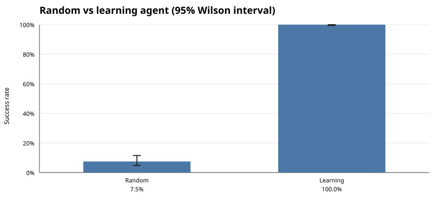
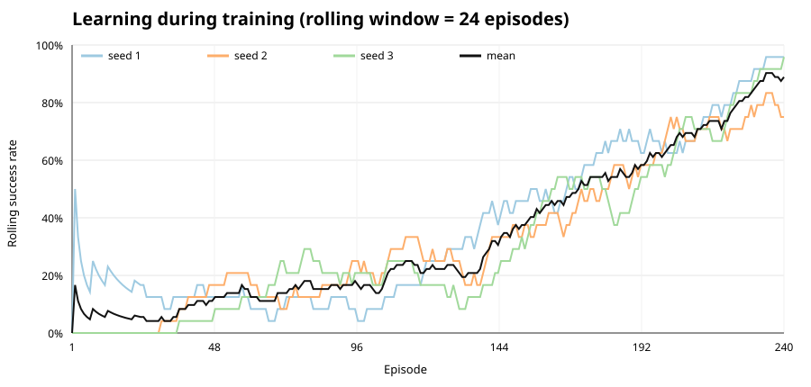
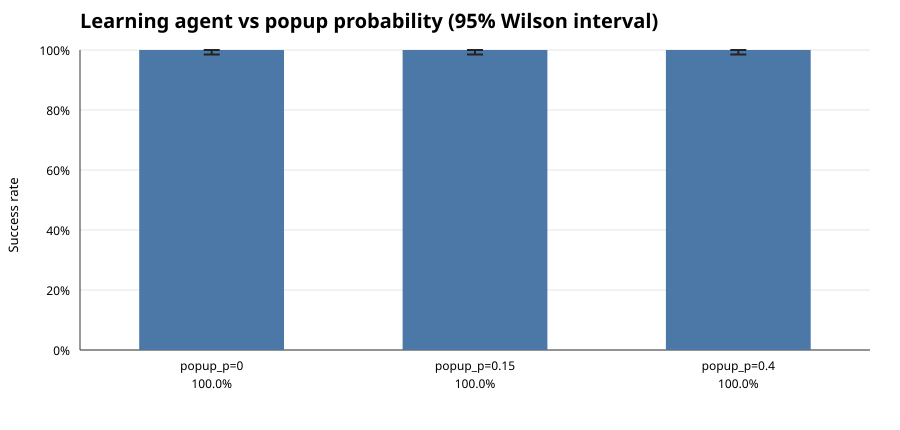

# MiniShop RL report

All numbers below are computed directly from the JSONL logs in `logs/`.

## Setup

- Environment: headless Chrome controlled over CDP.
- Goals: 4 items x 3 quantities = 12 goals.
- Learning agent: tabular Q-learning, 3 training seeds.
- Evaluation: greedy policy, 240 attempts per seed at `popup_p=0.15`.

## 1. Random vs learning success

| Agent | Successes | Attempts | Success rate | 95% Wilson CI |
|---|---:|---:|---:|---:|
| Random | 18 | 240 | 7.5% | 4.8% - 11.5% |
| Learning | 720 | 720 | 100.0% | 99.5% - 100.0% |



## 2. Learning curve

The chart shows each training seed plus the seed average. The rolling window is 24 episodes.



Final rolling training success: mean 88.9%, range 75.0% - 95.8% across 3 seeds.

## 3. Popup probability

| popup_p | Successes | Attempts | Success rate | 95% Wilson CI |
|---:|---:|---:|---:|---:|
| 0 | 252 | 252 | 100.0% | 98.5% - 100.0% |
| 0.15 | 252 | 252 | 100.0% | 98.5% - 100.0% |
| 0.4 | 252 | 252 | 100.0% | 98.5% - 100.0% |



Changing `popup_p` did not change the measured success rate. The environment dismisses the popup before the agent acts, so the popup is a timing obstacle rather than an information obstacle. The button-delay parameter is what actually changes the trajectory length and step timing.

## 4. Failure reasons

The final greedy policy had no failures in any of the three popup evaluations. The table below classifies failures observed during training, where epsilon-greedy exploration still takes random actions.

The three most common reasons are wrong item (139), ran out of 20 steps on product screen (113), ran out of 20 steps on cart screen (75).

| Reason | Count | Example |
|---|---:|---|
| wrong item | 139 | seed 1, episode 1, goal blue-mug x1, step 10, action click(0), cart [{'qty': 1, 'slug': 'red-shirt'}] |
| ran out of 20 steps on product screen | 113 | seed 1, episode 4, goal red-shirt x1, step 20, action click(3), cart [] |
| ran out of 20 steps on cart screen | 75 | seed 1, episode 9, goal green-plant x3, step 20, action click(1), cart [] |
| ran out of 20 steps on catalog screen | 58 | seed 1, episode 3, goal blue-mug x3, step 20, action click(2), cart [] |
| wrong quantity | 58 | seed 1, episode 30, goal red-shirt x3, step 15, action click(0), cart [{'qty': 1, 'slug': 'red-shirt'}] |
| ran out of 20 steps on newsletter screen | 11 | seed 1, episode 15, goal blue-mug x3, step 20, action click(0), cart [] |

## 5. Step timing

Across 19780 logged steps: median 42.0 ms, p95 87.0 ms, mean 57.8 ms, max 368 ms.

| Group | Steps | Median (ms) | p95 (ms) |
|---|---:|---:|---:|
| Action: click | 18953 | 41.0 | 77.0 |
| Action: wait | 827 | 308.0 | 316.0 |
| Popup: no popup | 17346 | 41.0 | 67.0 |
| Popup: popup | 2434 | 76.0 | 89.0 |
| Screen: cart | 4606 | 43.0 | 305.0 |
| Screen: catalog | 5979 | 43.0 | 308.0 |
| Screen: newsletter | 630 | 41.0 | 306.0 |
| Screen: product | 8565 | 41.0 | 75.0 |

Per step, wait actions are the slowest because they deliberately sleep for 300 ms. Click steps are much cheaper individually, but they dominate total wall-clock time because there are far more of them. Popup steps add roughly 35 ms because the environment must locate and click the dismiss button.

## 6. Surprising result

The most surprising result is that raising `popup_p` from 0 to 0.4 did not reduce success at all. The agent's bottleneck was not the popup itself but temporary button delays: the agent now waits whenever a non-disabled button is still hidden, which removes the race that used to cause wrong clicks.

## Reproduce

```bash
python3 -m http.server 8000 --directory site
cd rl
CHROME_BIN=/usr/bin/google-chrome cargo run -- train
CHROME_BIN=/usr/bin/google-chrome cargo run -- random
for p in 0 0.15 0.4; do
  CHROME_BIN=/usr/bin/google-chrome cargo run -- eval --seeds 1,2,3 --eval-episodes 7 --popup-p $p
done
python3 report.py
```
